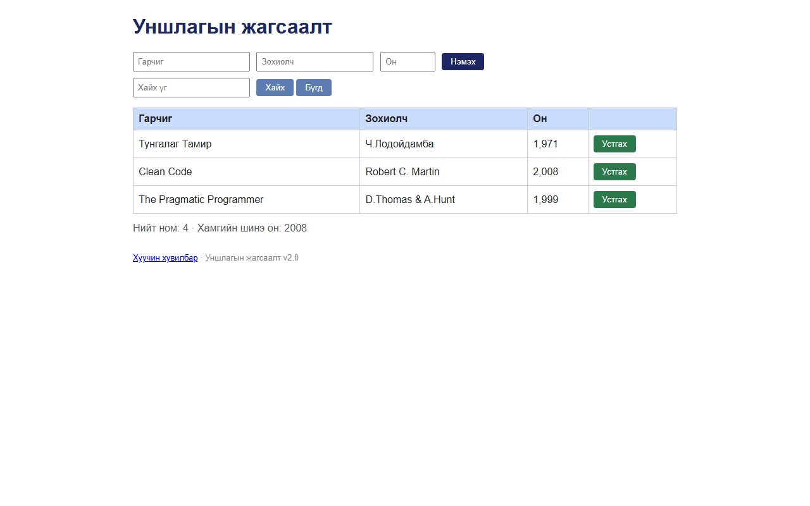

# BUG-01: Номын хүснэгтийн «Он» баганад он мянгатын таслалтай ("1,971") харагддаг

Орчин:  Уншлагын жагсаалт v2.0, Chromium 153 (Firefox 155-д мөн давтагдсан), Windows 11 Pro, 2026-10-15

Урьдчилсан нөхцөл: node app.js-ийг шинээр асаасан (анхны 3 ном)

## Дахин гаргах алхам
1. Браузераар http://localhost:3000 нээнэ.
2. Хүснэгтийн «Он» баганыг харна.

Хүлээгдэж байсан: «Он нь ... хүснэгтэд энгийн тоогоор (жишээ нь 1999) харагдана» — 1971, 2008, 1999.

Бодит үр дүн:     «Тунгалаг Тамир» — **1,971**, «Clean Code» — **2,008**, «The Pragmatic Programmer» —
                  **1,999**. Шинээр нэмсэн ном ч мөн адил (ж: 1872 → "1,872"); 1000-аас бага он
                  (999) таслалгүй харагдана.

Ноцтой байдал: Minor — өгөгдөл зөв хадгалагдсан (API: `"year":1971`), зөвхөн харагдах байдал буруу,
               гэвч он биш "мянга есөн зуун..." гэсэн тоо мэт уншигдаж хэрэглэгчийг төөрөгдүүлнэ.

Хавсралт:      

Олдсон аялал:  Supermodel (нүүр хуудсыг анх харахад)
