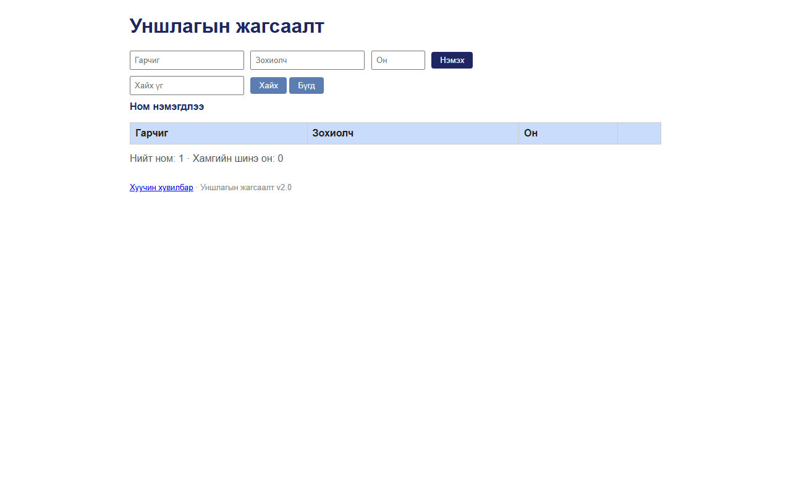

# BUG-02: «Нийт ном» тоолуур хүснэгтийн номын тооноос үргэлж 1-ээр их (API /api/stats ч буруу)

Орчин:  Уншлагын жагсаалт v2.0, Chromium 153 (Firefox 155-д мөн давтагдсан), Windows 11 Pro, 2026-10-15

Урьдчилсан нөхцөл: node app.js-ийг шинээр асаасан (анхны 3 ном)

## Дахин гаргах алхам
1. Браузераар http://localhost:3000 нээнэ — хүснэгтэд 3 ном байна.
2. Хүснэгтийн доорх «Нийт ном» мөрийг харна.
3. Терминалд: `curl -i localhost:3000/api/books` — 3 элементтэй массив.
4. Терминалд: `curl -i localhost:3000/api/stats`.
5. (Нэмэлт) Хүснэгтийн 3 номын «Устгах» товчийг бүгдийг дарж хүснэгтийг хоосолно.

Хүлээгдэж байсан: «"Нийт ном" тоолуур хүснэгтэд буй номын тоотой тэнцүү» — 3 (5-р алхмын дараа 0).

Бодит үр дүн:     2-р алхамд «**Нийт ном: 4** · Хамгийн шинэ он: 2008». 4-р алхамд
                  `HTTP/1.1 200 OK` `{"total":4,"newest":2008}` — жагсаалт 3 байхад total 4.
                  5-р алхмын дараа хүснэгт хоосон ч «**Нийт ном: 1** · Хамгийн шинэ он: 0»
                  (`/api/books` → `[]`, `/api/stats` → `{"total":1,...}`). Зөрүү 25 минут,
                  ~500 үйлдлийн турш тогтмол +1 байсан (хуримтлагддаггүй).

Ноцтой байдал: Major — серверийн тооцоолсон статистик (өгөгдлийн түвшин) буруу; API-ийн хэрэглэгч бүр
               буруу тоо авна, хоосон сан "1 номтой" гэж харагдана.

Хавсралт:       ·  ·
               evidence/bug-02-curl.txt (API)

Олдсон аялал:  Guidebook (дүрэм 7); Fed-Ex-ээр API түвшинд баталгаажсан
