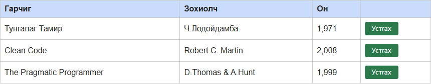

# BUG-03: Аюултай үйлдлийн «Устгах» товч улаан биш, ногоон өнгөтэй

Орчин:  Уншлагын жагсаалт v2.0, Chromium 153 (Firefox 155-д мөн давтагдсан), Windows 11 Pro, 2026-10-15

Урьдчилсан нөхцөл: node app.js-ийг шинээр асаасан (анхны 3 ном)

## Дахин гаргах алхам
1. Браузераар http://localhost:3000 нээнэ.
2. Хүснэгтийн мөр бүрийн баруун талын «Устгах» товчийн өнгийг харна
   (DevTools → товч → Computed → background-color).

Хүлээгдэж байсан: «Аюултай үйлдлийн товч (Устгах) улаан өнгөтэй».

Бодит үр дүн:     Товч **ногоон** (`background-color: rgb(44, 122, 75)`) — ихэнх UI-д ногоон нь
                  "зөвшөөрөх/амжилттай" утгатай тул устгах товч аюулгүй үйлдэл мэт харагдана.
                  Устгахад баталгаажуулах асуулт ч гардаггүй.

Ноцтой байдал: Minor — функц ажиллана, гэхдээ буруу өнгө санамсаргүй устгалтын эрсдэлийг нэмнэ.

Хавсралт:      

Олдсон аялал:  Supermodel
