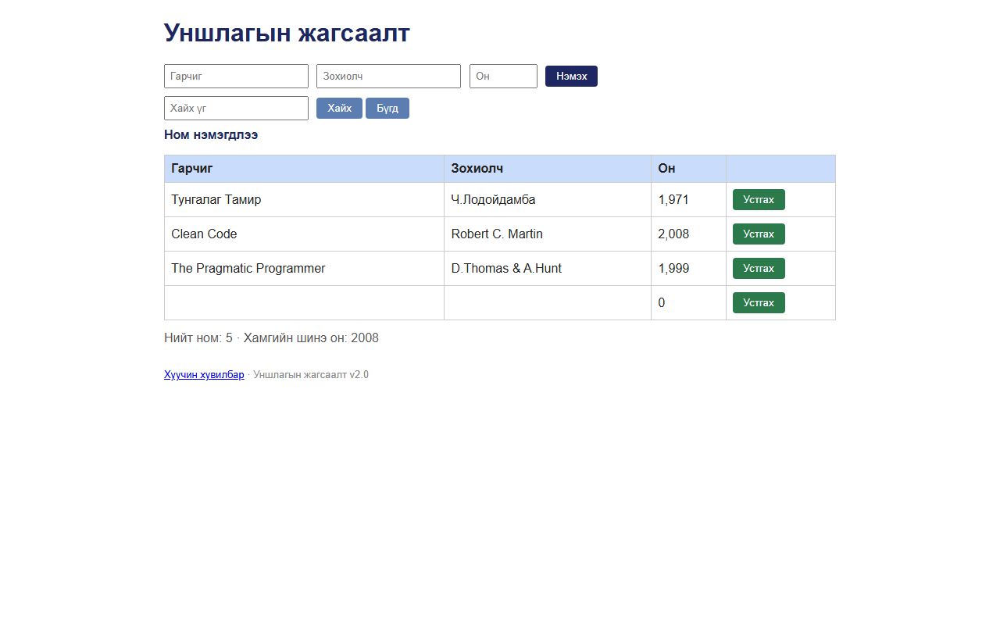

# BUG-04: Гарчиг, Зохиолч, Он талбарыг хоосон орхиход ном нэмэгдэж, «Ном нэмэгдлээ» гэж харагддаг

Орчин:  Уншлагын жагсаалт v2.0, Chromium 153 (Firefox 155-д мөн давтагдсан), Windows 11 Pro, 2026-10-15

Урьдчилсан нөхцөл: node app.js-ийг шинээр асаасан (анхны 3 ном)

## Дахин гаргах алхам
1. Браузераар http://localhost:3000 нээнэ.
2. Гарчиг, Зохиолч, Он гурван талбарыг **хоосон** үлдээнэ.
3. «Нэмэх» товчийг дарна.

Хүлээгдэж байсан: «Ном нэмэхэд Гарчиг, Зохиолч, Он гурван талбар бүгд заавал бөглөгдсөн байх ёстой;
                  дутуу бол ном нэмэгдэхгүй, ойлгомжтой алдааны мессеж харагдана».

Бодит үр дүн:     «**Ном нэмэгдлээ**» мессеж гарч, хүснэгтийн төгсгөлд гарчиг, зохиолч нь хоосон,
                  он нь «**0**» гэсэн 4 дэх мөр нэмэгдэнэ. Ижил шалтгааны хувилбарууд: зөвхөн Гарчиг
                  бөглөх, Гарчиг+Зохиолч (он хоосон), гурвууланд нь зөвхөн зай ("   ") бичих — бүгд
                  нэмэгддэг. API ч шалгадаггүй: `curl -i -X POST localhost:3000/api/books
                  -H 'Content-Type: application/json' -d '{}'` → `HTTP/1.1 201 Created`.
                  Апп ямар ч нөхцөлд алдааны мессеж харуулдаггүй.

Ноцтой байдал: Major — заавал талбарын дүрэм огт хэрэгждэггүй; хог өгөгдөл (нэргүй ном) санд орж,
               тоолуур, хайлтыг бохирдуулна.

Хавсралт:      

Олдсон аялал:  Couch Potato
