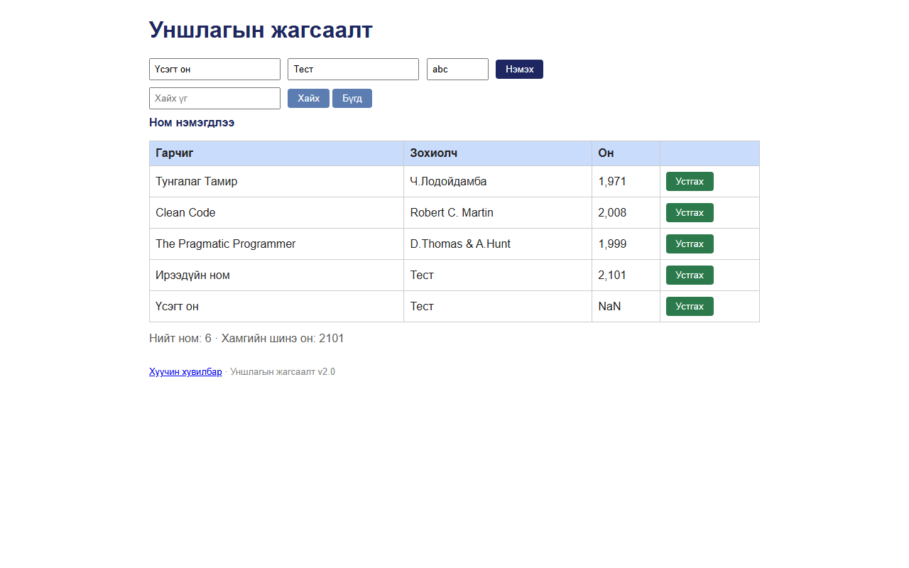

# BUG-06: Он талбар 1000-2100 хязгаар, бүхэл тоо, тоон эсэхийг шалгадаггүй — 2101, "abc" зэрэг он хадгалагддаг

Орчин:  Уншлагын жагсаалт v2.0, Chromium 153 (Firefox 155-д мөн давтагдсан), Windows 11 Pro, 2026-10-15

Урьдчилсан нөхцөл: node app.js-ийг шинээр асаасан (анхны 3 ном)

## Дахин гаргах алхам
1. Браузераар http://localhost:3000 нээнэ.
2. Гарчиг: `Ирээдүйн ном`, Зохиолч: `Тест`, Он: `2101` гэж бичээд «Нэмэх» дарна.
3. Гарчиг: `Үсэгт он`, Зохиолч: `Тест`, Он: `abc` гэж бичээд «Нэмэх» дарна.

Хүлээгдэж байсан: «Он нь 1000-2100 хоорондох бүхэл тоо» — хоёулаа нэмэгдэхгүй, алдааны мессеж гарна.

Бодит үр дүн:     Хоёулаа «Ном нэмэгдлээ» гэж нэмэгдэнэ: 2101 → «2,101», abc → «**NaN**».
                  «Хамгийн шинэ он: **2101**» болж хүчингүй он статистикт орно. Мөн 999, 1999.5,
                  -5, 2100.0001 (хүснэгтэд "2,100" гэж нуугдана), "0x7D0" (хүснэгтэд "2,000"),
                  API-аар `"year": true`, `{"a":1}` — бүгд хүлээн авагдсан. API тэдгээрийг бичсэн
                  тэмдэгт мөрөөр нь (`"year":"0x7D0"`) хадгалдаг тул GUI ба API-ийн өгөгдөл зөрдөг.

Ноцтой байдал: Major — специйн тодорхой дүрмийг зөрчиж, буруу өгөгдөл санд орно; зарим буруу утгыг
               хүснэгт бөөрөнхийлж нуудаг тул хэрэглэгч анзаарахгүй.

Хавсралт:      

Олдсон аялал:  Antisocial; Fed-Ex-ээр GUI ↔ API зөрүү олдсон
