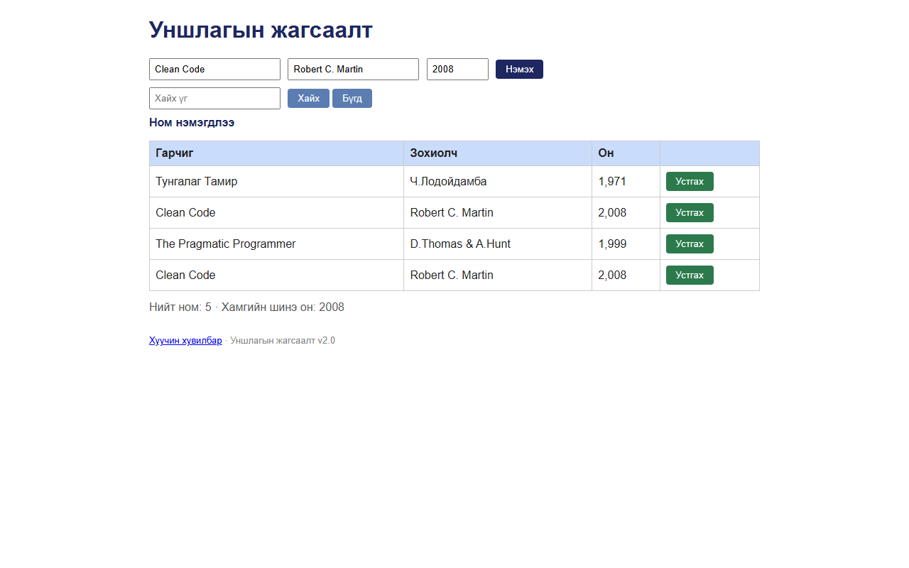

# BUG-07: Ижил гарчиг, зохиолчтой ном давхардаж нэмэгддэг

Орчин:  Уншлагын жагсаалт v2.0, Chromium 153 (Firefox 155-д мөн давтагдсан), Windows 11 Pro, 2026-10-15

Урьдчилсан нөхцөл: node app.js-ийг шинээр асаасан (анхны 3 ном)

## Дахин гаргах алхам
1. Браузераар http://localhost:3000 нээнэ (хүснэгтэд «Clean Code / Robert C. Martin / 2,008» байгаа).
2. Гарчиг: `Clean Code`, Зохиолч: `Robert C. Martin`, Он: `2008` гэж бичнэ.
3. «Нэмэх» дарна.

Хүлээгдэж байсан: «Ижил гарчиг, зохиолчтой ном давхардуулж нэмэгдэхгүй».

Бодит үр дүн:     «Ном нэмэгдлээ» гээд хүснэгтэд **хоёр** «Clean Code / Robert C. Martin / 2,008»
                  мөр харагдана («Нийт ном: 5»). «Нэмэх»-ийг хурдан 3 удаа дарахад 3 ижил ном
                  үүснэ; урд/хойно зайтай "  Clean Code  " ч хадгалагдаж (trim хийдэггүй) хүснэгтэд
                  яг ижил харагдана.

Ноцтой байдал: Major — специйн дүрэм зөрчиж, давхар бичлэг тоолуур, хайлтын үр дүнг бохирдуулна.

Хавсралт:      

Олдсон аялал:  Guidebook (дүрэм 3); Obsessive-Compulsive (давхар дарах)
