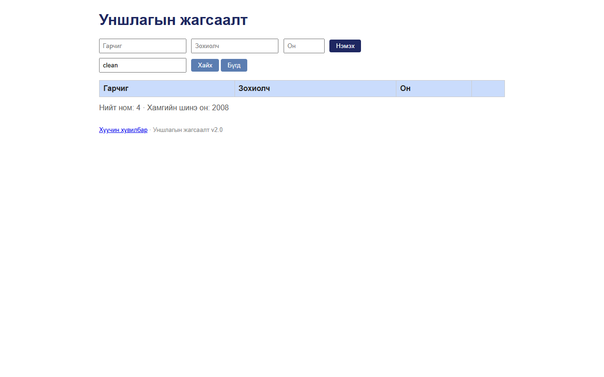

# BUG-08: Хайлт том/жижиг үсэг ялгадаг — "clean" гэж хайхад «Clean Code» олдохгүй

Орчин:  Уншлагын жагсаалт v2.0, Chromium 153 (Firefox 155-д мөн давтагдсан), Windows 11 Pro, 2026-10-15

Урьдчилсан нөхцөл: node app.js-ийг шинээр асаасан (анхны 3 ном)

## Дахин гаргах алхам
1. Браузераар http://localhost:3000 нээнэ.
2. «Хайх үг» талбарт `clean` (бүгд жижиг үсгээр) гэж бичээд «Хайх» дарна.
3. Талбарыг `Clean` болгоод дахин «Хайх» дарна.

Хүлээгдэж байсан: «Хайлт гарчиг болон зохиолчоос хайх ба том/жижиг үсэг ЯЛГАХГҮЙ» — 2, 3-р алхам
                  хоёулаа «Clean Code» мөрийг харуулна.

Бодит үр дүн:     2-р алхамд хүснэгт **хоосон** (0 мөр, «олдсонгүй» мессеж ч алга); 3-р алхамд
                  «Clean Code» 1 мөр. Зохиолчоор ч мөн адил: `martin` → 0, `Martin` → 1;
                  кирилл: `тунгалаг` → 0, `Тунгалаг` → 1.

Ноцтой байдал: Major — хэрэглэгчид ихэвчлэн жижиг үсгээр хайдаг тул байгаа номоо "байхгүй" гэж
               ойлгож, дахин нэмэх (BUG-07 давхардал) эрсдэлтэй.

Хавсралт:      

Олдсон аялал:  Guidebook (дүрэм 4)
