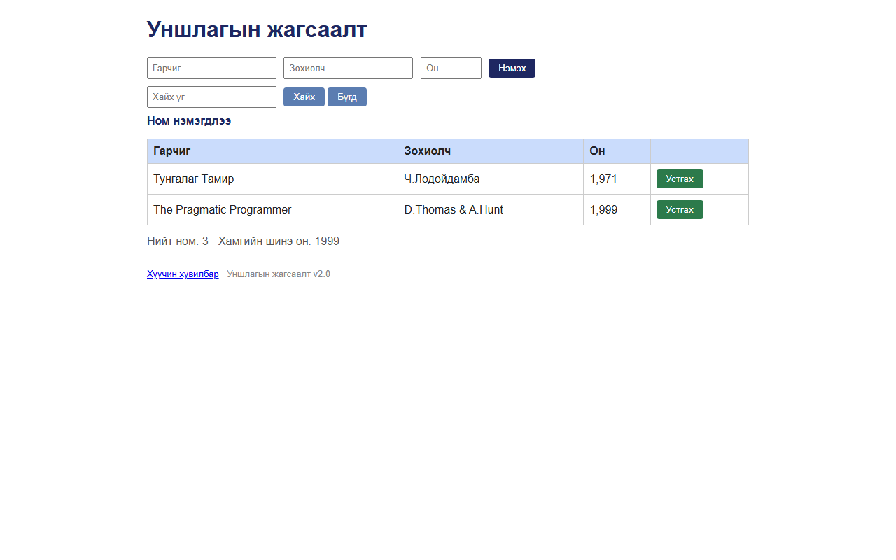

# BUG-09: Ном устгасны дараа «Ном нэмэгдлээ» гэсэн буруу мессеж гардаг

Орчин:  Уншлагын жагсаалт v2.0, Chromium 153 (Firefox 155-д мөн давтагдсан), Windows 11 Pro, 2026-10-15

Урьдчилсан нөхцөл: node app.js-ийг шинээр асаасан (анхны 3 ном)

## Дахин гаргах алхам
1. Браузераар http://localhost:3000 нээнэ.
2. «Clean Code» мөрийн «Устгах» товчийг дарна.
3. Хайлтын товчнуудын доорх тод мессежийг харна.

Хүлээгдэж байсан: «Үйлдэл бүрийн дараах мессеж тухайн үйлдэлдээ тохирно» — жишээ нь «Ном устгагдлаа».

Бодит үр дүн:     Мөр устсан (хүснэгтэд 2 ном үлдэнэ) боловч мессеж «**Ном нэмэгдлээ**».

Ноцтой байдал: Minor — үйлдэл зөв, мессеж эсрэг утгатай тул хэрэглэгч юу болсныг буруу ойлгоно.

Хавсралт:      

Олдсон аялал:  Guidebook (дүрэм 5)
