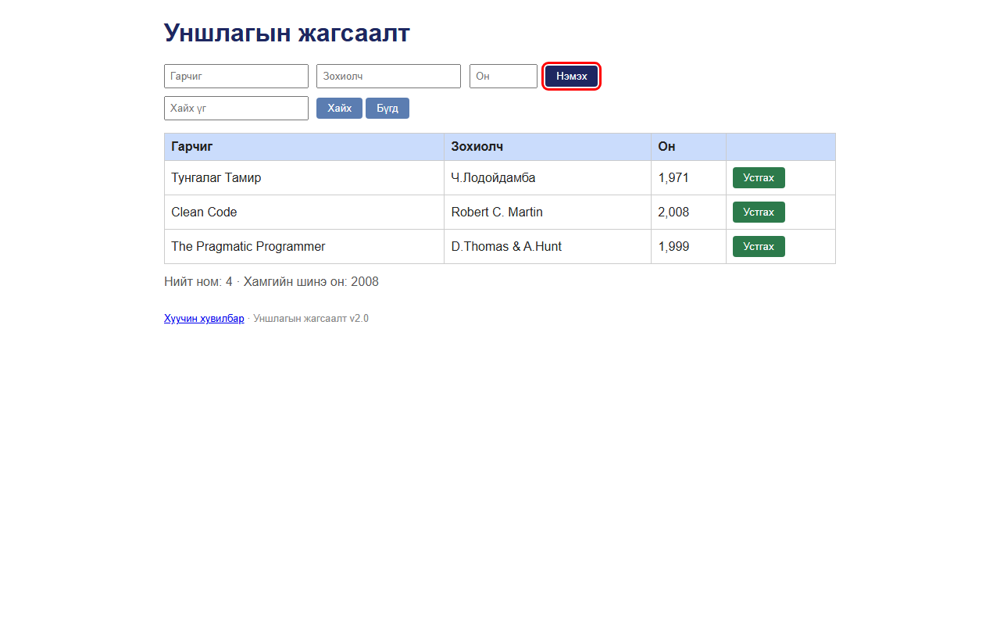

# BUG-10: «Нэмэх» товчны сүүлийн үсэг кирилл «х» биш, латин «x» (U+0078) — текстийн алдаа

Орчин:  Уншлагын жагсаалт v2.0, Chromium 153 (Firefox 155-д мөн давтагдсан), Windows 11 Pro, 2026-10-15

Урьдчилсан нөхцөл: node app.js-ийг шинээр асаасан (анхны 3 ном)

## Дахин гаргах алхам
1. Браузераар http://localhost:3000 нээнэ.
2. Ctrl+F дарж хайлтын мөрөнд кирилл үсгээр `Нэмэх` гэж бичнэ.
3. (Баталгаа) DevTools Console-д:
   `[...document.querySelector('button.add').textContent].map(c => c.codePointAt(0).toString(16))`

Хүлээгдэж байсан: «текстүүд үсгийн алдаагүй» — товч кирилл «Нэмэх» (сүүлийн үсэг х = U+0445),
                  Ctrl+F-ээр олдоно.

Бодит үр дүн:     2-р алхамд **0 олдоц** — товч дээр «Нэмэx» харагдаж байгаа ч хайлтад олдохгүй.
                  3-р алхамд `['41d','44d','43c','44d','78']` — сүүлийн тэмдэгт **0x78 = латин x**
                  («Хайх» товчны х нь зөв 0x445). Харьцуулахад `Нэмэx` (латин x)-ээр хайвал олдоно.

Ноцтой байдал: Cosmetic — нүдэнд бараг ялгагдахгүй ч хуудсаас хайх, дэлгэц уншигч (буруу дуудлага),
               автомат тест (`getByText('Нэмэх')` олохгүй) зэрэгт нөлөөлнө.

Хавсралт:       (товчийг улаан хүрээгээр тодруулсан)

Олдсон аялал:  Supermodel
