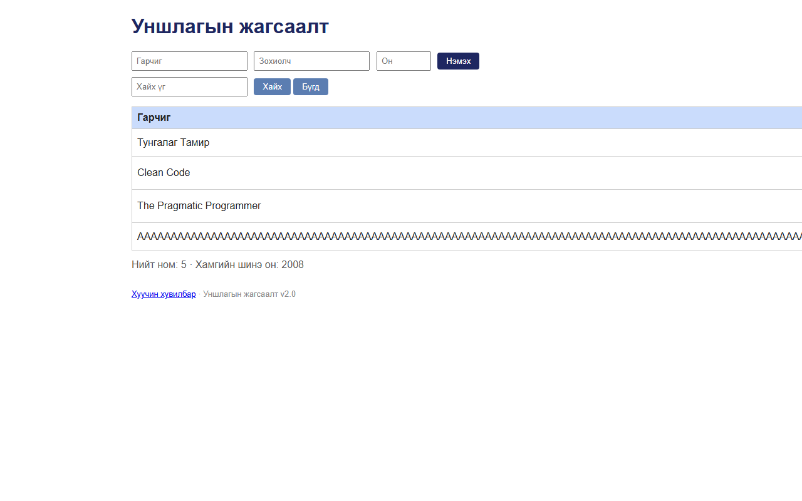

# BUG-11: Зайгүй урт гарчигтай ном нэмэхэд хүснэгт хуудаснаас хэтэрч, Зохиолч/Он/Устгах баганууд дэлгэцээс гардаг

Орчин:  Уншлагын жагсаалт v2.0, Chromium 153 (Firefox 155-д мөн давтагдсан), Windows 11 Pro, 2026-10-15

Урьдчилсан нөхцөл: node app.js-ийг шинээр асаасан (анхны 3 ном)

Цонхны хэмжээ: 1280×800

## Дахин гаргах алхам
1. Браузераар http://localhost:3000 нээнэ.
2. Гарчиг талбарт зайгүй 100 тэмдэгт хуулж тавина:
   `AAAAAAAAAAAAAAAAAAAAAAAAAAAAAAAAAAAAAAAAAAAAAAAAAAAAAAAAAAAAAAAAAAAAAAAAAAAAAAAAAAAAAAAAAAAAAAAAAAAA`
3. Зохиолч: `Урт гарчиг`, Он: `2000` гээд «Нэмэх» дарна.

Хүлээгдэж байсан: «хүснэгт ямар ч урттай оролтод эвдрэхгүй» — урт текст нүдэн дотроо мөр шилжинэ
                  эсвэл таслагдана, хүснэгт 860px өргөнтэй хэвээр.

Бодит үр дүн:     Хүснэгт ~1350px болж хуудас хэвтээ гүйлгэлттэй болно; 1280px цонхонд зөвхөн
                  «Гарчиг» багана харагдаж, **Зохиолч, Он, Устгах** баганууд дэлгэцээс гарна.
                  Зайтай урт текст (300 тэмдэгт, үгтэй) зөв мөр шилждэг — асуудал нь зайгүй урт үг
                  (URL, ISBN г.м.) дээр, ~60 тэмдэгтээс эхэлнэ.

Ноцтой байдал: Minor — өгөгдөл зөв, гэхдээ бүх мөрийн «Устгах» товч харагдахгүй болж хүснэгт
               ашиглах боломжгүй болно.

Хавсралт:      

Олдсон аялал:  Supermodel / Antisocial (маш урт оролт)
