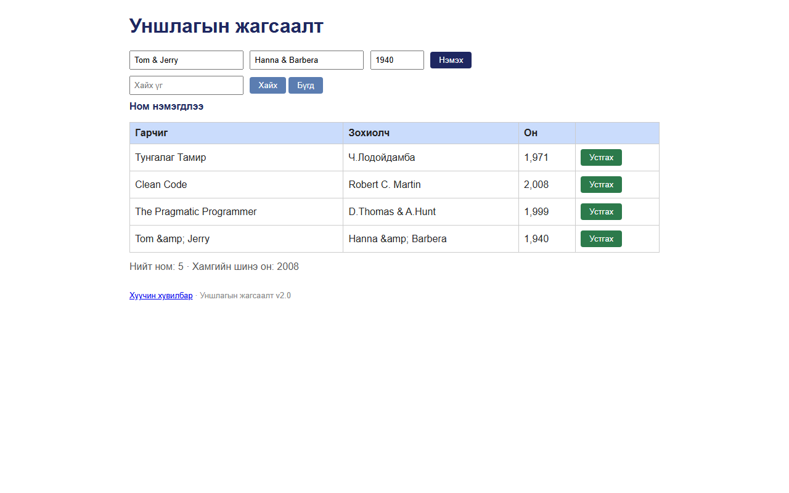

# BUG-15: Гарчиг/зохиолчид «&», «<», «>» орсон ном «Tom &amp;amp; Jerry» болж эвдэрч хадгалагддаг

Орчин:  Уншлагын жагсаалт v2.0, Chromium 153 (Firefox 155-д мөн давтагдсан), Windows 11 Pro, 2026-10-15

Урьдчилсан нөхцөл: node app.js-ийг шинээр асаасан (анхны 3 ном)

## Дахин гаргах алхам
1. Браузераар http://localhost:3000 нээнэ.
2. Гарчиг: `Tom & Jerry`, Зохиолч: `Hanna & Barbera`, Он: `1940` гээд «Нэмэх» дарна.
3. Хүснэгтийн сүүлийн мөрийг харна.
4. «Хайх үг» талбарт `Tom & J` гээд «Хайх» дарна.
5. Терминалд: `curl -i localhost:3000/api/books`

Хүлээгдэж байсан: Эрүүл ухаан: хэрэглэгчийн бичсэн текст яг хэвээрээ хадгалагдаж харагдана
                  («Tom & Jerry») — анхны «D.Thomas & A.Hunt» ном шиг.

Бодит үр дүн:     3-р алхамд «**Tom &amp;amp; Jerry**», «Hanna &amp;amp; Barbera». 4-р алхамд 0 мөр —
                  хэрэглэгч өөрийн бичсэн гарчгаар номоо олж чадахгүй. 5-р алхамд
                  `"title":"Tom &amp; Jerry"` — өгөгдөл сервер дээрээ HTML entity болж эвдэрсэн.
                  `<b>тод</b>` → «&amp;lt;b&amp;gt;тод&amp;lt;/b&amp;gt;». API-аар шууд илгээсэн ч мөн адил
                  (evidence/bug-15-curl.txt). `'`, `"` тэмдэгт эвдрэхгүй. (XSS ажиллаагүй — сайн.)

Ноцтой байдал: Major — хэрэглэгчийн өгөгдлийг санамсаргүйгээр өөрчилж хадгалдаг (data corruption);
               API-ийн бусад хэрэглэгч ч эвдэрсэн утга авна.

Хавсралт:       · evidence/bug-15-curl.txt

Олдсон аялал:  Fed-Ex (тусгай тэмдэгтийн өгөгдлийг GUI → хүснэгт → хайлт → API хүртэл дагав)
