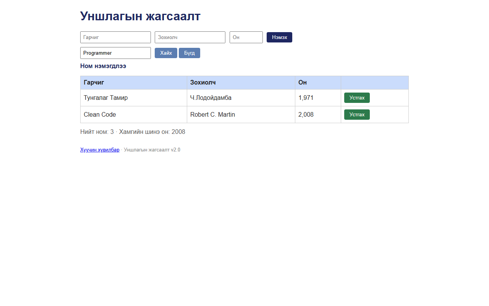

# BUG-16: Хайлтын үр дүнгээс ном устгахад хүснэгт бүх жагсаалт руу үсэрч, хайх талбар ба хүснэгт зөрдөг

Орчин:  Уншлагын жагсаалт v2.0, Chromium 153 (Firefox 155-д мөн давтагдсан), Windows 11 Pro, 2026-10-15

Урьдчилсан нөхцөл: node app.js-ийг шинээр асаасан (анхны 3 ном)

## Дахин гаргах алхам
1. Браузераар http://localhost:3000 нээнэ.
2. «Хайх үг» талбарт `Programmer` гээд «Хайх» дарна — зөвхөн «The Pragmatic Programmer».
3. Тэр мөрийн «Устгах» дарна.

Хүлээгдэж байсан: Эрүүл ухаан: хайлтын контекст хадгалагдана (хүснэгт "Programmer"-т тохирох мөргүй,
                  хоосон болно) эсвэл хайх талбар цэвэрлэгдэнэ — талбар ба хүснэгт нийцтэй байна.

Бодит үр дүн:     Хүснэгт «Тунгалаг Тамир», «Clean Code» (хайлтад огт тохирохгүй) номуудыг харуулж,
                  хайх талбарт «Programmer» хэвээр; мессеж «Ном нэмэгдлээ» (BUG-09).
                  «Бүгд» товч дарахад ч хайх талбар цэвэрлэгддэггүй.

Ноцтой байдал: Minor — хэрэглэгч "Programmer" гэж хайхад эдгээр ном гарсан гэж андуурна.

Хавсралт:      

Олдсон аялал:  Guidebook (хайлт + устгах хослол)
