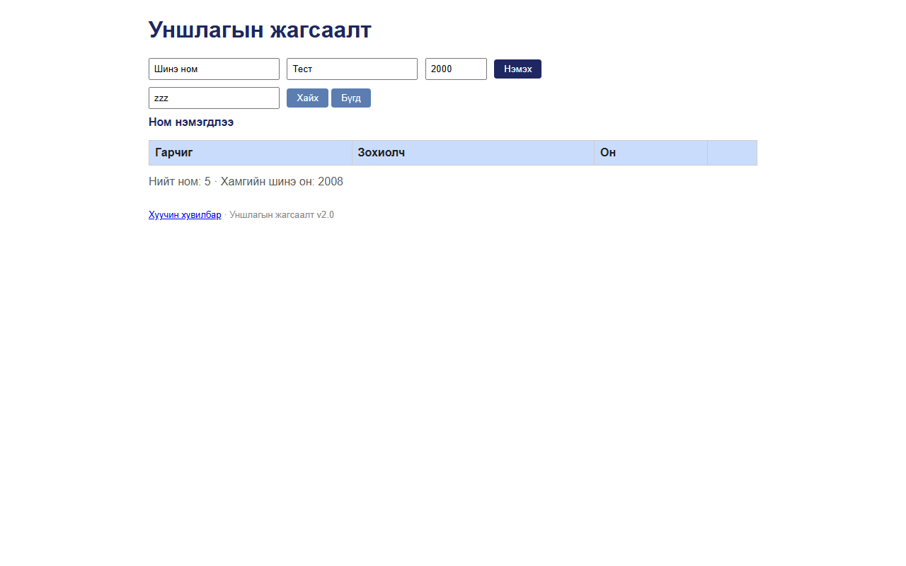

# BUG-17: Хайлт мессежийг шинэчилдэггүй — илэрц 0 байхад өмнөх «Ном нэмэгдлээ» үлддэг

Орчин:  Уншлагын жагсаалт v2.0, Chromium 153 (Firefox 155-д мөн давтагдсан), Windows 11 Pro, 2026-10-15

Урьдчилсан нөхцөл: node app.js-ийг шинээр асаасан (анхны 3 ном)

## Дахин гаргах алхам
1. Браузераар http://localhost:3000 нээнэ.
2. Гарчиг: `Шинэ ном`, Зохиолч: `Тест`, Он: `2000` гээд «Нэмэх» дарна.
3. «Хайх үг» талбарт `zzz` гээд «Хайх» дарна.

Хүлээгдэж байсан: «Үйлдэл бүрийн дараах мессеж тухайн үйлдэлдээ тохирно» — хайлтын дараа
                  жишээ нь «Олдсонгүй» (эсвэл мессежгүй).

Бодит үр дүн:     Хүснэгт хоосон (0 мөр), харин мессеж «**Ном нэмэгдлээ**» хэвээр — хайлт ямар ч
                  мессеж тавьдаггүй тул өмнөх үйлдлийнх үлдэж төөрөгдүүлнэ.

Ноцтой байдал: Minor — мессеж хайлтын үр дүнтэй зөрчилдөнө.

Хавсралт:      

Олдсон аялал:  Supermodel / Guidebook (дүрэм 5)
